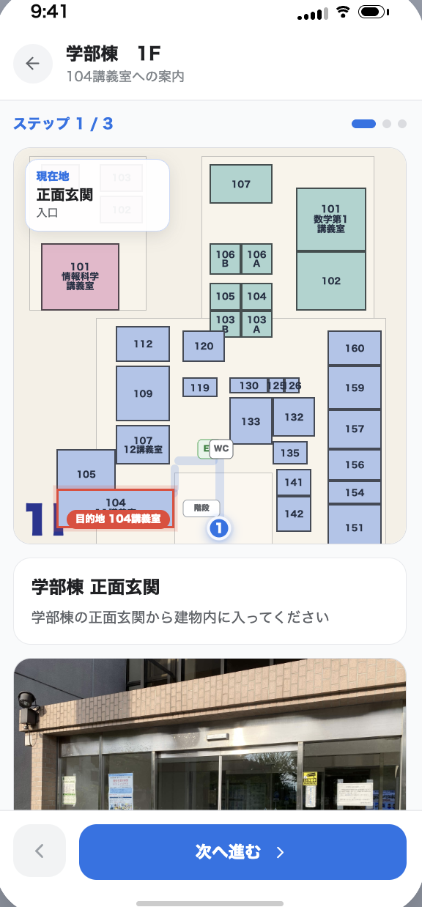

# キャンパス授業ナビ(仮)

時間割から授業を選ぶだけで、現在地から建物までの道順と、建物内の教室の位置を続けて確認できるモバイル向け Web アプリのプロトタイプ。

対象ユーザーは、大学内で授業間を移動する学生(特に新入生や、初めて使う教室が多い学生)。詳しい背景・課題設定は [docs/t06中間報告.md](docs/t06中間報告.md) を参照。

## アプリのスクショ

| 時間割画面 | キャンパスマップ画面 | フロア案内画面 |
| --- | --- | --- |
|  |  |  |
| 曜日・時限ごとに授業を表示し、授業を検索して登録できる。 | 選んだ授業の建物までの道順と、現在地からの徒歩時間(例: 徒歩約3分)を表示する。 | 目的の教室がある棟・階のフロアマップを表示する(フロアマップのデータは未作成)。 |

全画面の遷移をまとめた図は [画面遷移図/画面遷移図.png](画面遷移図/画面遷移図.png)。スクショと遷移図は MVP 確定前の版で、フロア案内画面の写真と3ステップ案内は現在のアプリにはない。

## 仕様(MVPの必須機能)

MVP 最終決定の項目と、それを実装している場所。

### 時間割

| MVP 項目 | 内容 | 実装 |
| --- | --- | --- |
| 時間割の作成と編集 | 講義は授業登録検索から登録する(右上の「+」か、時間割の空きコマをタップ)。編集モードで講義をタップすると内容を変更、×で削除できる。同じ曜日・時限への重複登録はできない | [Timetable.tsx](src/app/components/Timetable.tsx)、[CourseEditModal.tsx](src/app/components/CourseEditModal.tsx) |
| 授業登録検索(授業名、曜日、何コマ、教授の名前) | 授業名・曜日・何コマ・教員名の4つの条件で授業一覧を絞り込み、結果の「登録」ボタンで時間割に入れる。条件は組み合わせられ、空きコマから開いたときはその曜日・時限が最初から選ばれている。結果は曜日・時限ごとにまとめ、最初は空いているコマの授業だけを表示する(「空きコマのみ」を外すと登録済みのコマも出る)。一致した文字は黄色で強調する。モック環境のため、該当が3件未満のときは検索条件どおりの模擬の授業を自動で作って結果に出す | [CourseSearchModal.tsx](src/app/components/CourseSearchModal.tsx)、[catalog.ts](src/app/data/catalog.ts)、[mockCourses.ts](src/app/data/mockCourses.ts) |
| 時間割表に講義名, 講義室, 棟, 階層を表示 | 各セルに講義名・棟・階・教室番号を表示する | [Timetable.tsx](src/app/components/Timetable.tsx) |
| キャンパス自由検索(教室名, 棟の名前) | **未実装**。時間割画面の検索欄を削除したため、いまは入口がない(コミット 8d359872 までは時間割画面の検索欄にあった) | — |
| 曜日時間のフォーマット | 曜日・時限・時刻の表記を「木曜 1限 8:50–10:20」の形にそろえる。表記は1つのファイルの関数で作る | [schedule.ts](src/app/lib/schedule.ts) |

### キャンパスマップ

| MVP 項目 | 内容 | 実装 |
| --- | --- | --- |
| 現在地(GPS) | ブラウザの位置情報(Geolocation API)で現在地を取り、地図上に表示する。位置情報が許可されていない・キャンパスの外にいる・取得できないときは、正門を仮の現在地にして理由を表示する | [useCampusLocation.ts](src/app/hooks/useCampusLocation.ts) |
| 大学マップ | 建物・道路・緑地を描いたキャンパスマップ。目的の建物を強調し、ピンを立てる | [CampusMap.tsx](src/app/components/CampusMap.tsx)、[campus.ts](src/app/data/campus.ts) |
| 方角 | 北を示す方位磁針に加え、スマホの方角センサーで向いている方角を現在地マーカーに扇形で表示する。iPhone の Safari では「向いている方角を表示」ボタンを押して許可する。PC では表示されない | [useCampusLocation.ts](src/app/hooks/useCampusLocation.ts)、[CampusMap.tsx](src/app/components/CampusMap.tsx) |
| 案内経路 | 現在地から目的の建物の入口まで、道路に沿った最短経路を描き、徒歩時間を計算する | [campus.ts](src/app/data/campus.ts) の `findRoute` |

### フロアマップ

| MVP 項目 | 内容 | 実装 |
| --- | --- | --- |
| フロアマップ | **未実装(データ待ち)**。画面には「ここにフロアマップを表示」という枠と、行き先の棟・階・教室だけを表示している | [FloorMap.tsx](src/app/components/FloorMap.tsx) |
| 目的の教室のピン | **未実装(データ待ち)**。フロアマップのデータができたら、教室番号で部屋を探してピンを立てる | [FloorMap.tsx](src/app/components/FloorMap.tsx) |

### 現在の制約

| 制約 | 対応方法 |
| --- | --- |
| キャンパスマップは架空の配置で、GPS の緯度経度との対応が未設定(`CAMPUS_GEO = null`)。このため今は常に正門を起点に案内する | [campus.ts](src/app/data/campus.ts) の `CAMPUS_GEO` に、地図の北端・南端の緯度と西端・東端の経度を入れる |
| フロアマップのデータがまだない | 棟・階ごとの部屋の配置データを用意する |
| 授業一覧はダミーデータ(手書きのサンプル19件と、各曜日・各コマ3件ずつの自動生成で計94件)。検索結果が3件未満のときは模擬の授業を自動で作る | [catalog.ts](src/app/data/catalog.ts) を実際のシラバスのデータに置き換え、[mockCourses.ts](src/app/data/mockCourses.ts) の模擬データを外す |
| 時間割の変更はページを開いている間だけ保持され、再読み込みすると初期状態に戻る | 保存(永続化)は未実装 |
| スマホのブラウザで位置情報と方角センサーを使うには HTTPS で配信する必要がある(PC の `localhost` は例外) | 公開するときは HTTPS のホスティング(Vercel、Netlify、GitHub Pages など)を使う |

発展機能の検討リストは [docs/t06中間報告.md](docs/t06中間報告.md) の「発展機能として検討するもの」を参照。

## ドキュメントの在処

| ドキュメント | 内容 |
| --- | --- |
| [docs/t06中間報告.md](docs/t06中間報告.md) | 対象ユーザー・課題設定・MVP機能・利用フローを含む中間報告書 |
| [docs/中間報告改良版.md](docs/中間報告改良版.md) | 中間報告の改良版 |
| [docs/システム構成.md](docs/システム構成.md) | 画面構成、入力・処理・出力、案内に使う情報の一覧 |
| [docs/利用フロー.md](docs/利用フロー.md) | 利用者が時間割から講義室入口に着くまでの操作フロー |
| [docs/スライド.md](docs/スライド.md) | 発表用スライドのMarkdownソース(Marp形式) |
| [docs/pdf/](docs/pdf/) | 上記ドキュメントをまとめたPDF(例: 利用フローとシステム構成.pdf) |
| [guidelines/Guidelines.md](guidelines/Guidelines.md) | UI実装のガイドライン |
| [ATTRIBUTIONS.md](ATTRIBUTIONS.md) | 使用素材のクレジット |

## 起動方法

```bash
npm i        # 依存パッケージのインストール
npm run dev  # 開発サーバーを起動(Vite)
```

本番ビルドは `npm run build`(Viteで `dist/` に出力)。

## Skillについて

このリポジトリには `.claude/skills/` に、Claude Code がドキュメント作成時に自動的に使うSkillを2つ用意している。

| Skill | 用途 |
| --- | --- |
| [concrete-writing](.claude/skills/concrete-writing/SKILL.md) | 報告書やREADMEなどを書く際に「様々な」「適切に」のような抽象表現を検出し、数値・固有名詞を伴う具体的な表現に置き換える。 |
| [md-to-pdf](.claude/skills/md-to-pdf/SKILL.md) | Markdownドキュメントを headless Chrome でPDF化する。`scripts/md_to_pdf/run.sh` を使い、表紙・目次付きのA4 PDFを `docs/pdf/` に生成する。 |

## 使用技術

| 分類 | 技術 |
| --- | --- |
| フレームワーク | React 18, Vite 6 |
| 言語 | TypeScript |
| スタイリング | Tailwind CSS 4, `@tailwindcss/vite` |
| UIコンポーネント | Radix UI, MUI (`@mui/material`), shadcn系コンポーネント一式(`src/app/components/ui/`) |
| フォーム | react-hook-form |
| ルーティング | react-router |
| その他 | lucide-react(アイコン)、sonner(トースト通知)、recharts(グラフ)、date-fns |
| 位置情報 | ブラウザの Geolocation API(現在地)、DeviceOrientationEvent(方角) |
| PDF生成 | Node.js + marked + headless Chrome(`scripts/md_to_pdf/`) |

このプロジェクトは Figma Make で生成したコードバンドルを起点にしている。元デザインは [Figma](https://www.figma.com/design/cpKA0CQzFXUiVBOxrLYnWk/%E3%83%A2%E3%83%90%E3%82%A4%E3%83%AB%E3%83%9E%E3%83%83%E3%83%97%E3%83%97%E3%83%AD%E3%83%88%E3%82%BF%E3%82%A4%E3%83%97) を参照。
